

# From Freehand Demonstrations to Autonomous Robotic Ultrasound

### An Anatomy-Anchored Learning Framework

**Anonymous Authors**

<!-- TODO: replace the # links once available -->

**Collect by hand. Deploy on robots.**

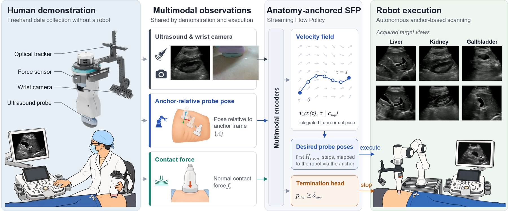

---

## TL;DR

A sonographer scans freehand with an instrumented probe — **no robot needed during data collection**. We learn a Streaming Flow Policy that moves the probe **relative to an anatomical anchor** instead of the robot base, using ultrasound, a probe-mounted camera and contact force. The same policy then runs autonomously on **different robots, without retraining**, reaching **88–96 % success on 16 unseen participants** across kidney, gallbladder, liver and radial-artery scans.

<table>
  <tr>
    <td align="center" width="50%">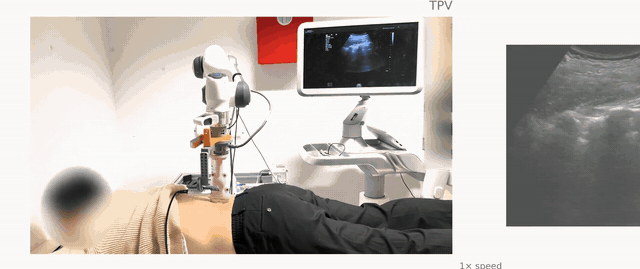 <b>Kidney</b> · longitudinal view</td>
    <td align="center" width="50%">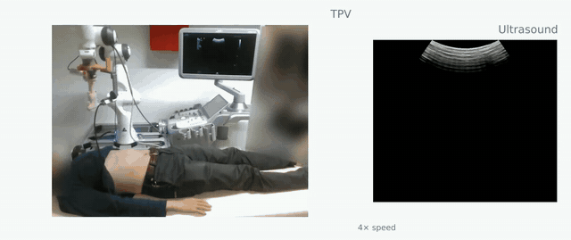 <b>Gallbladder</b> · longitudinal view</td>
  </tr>
  <tr>
    <td align="center" width="50%">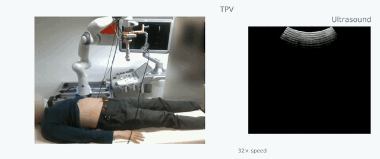 <b>Liver</b> · left portal vein</td>
    <td align="center" width="50%">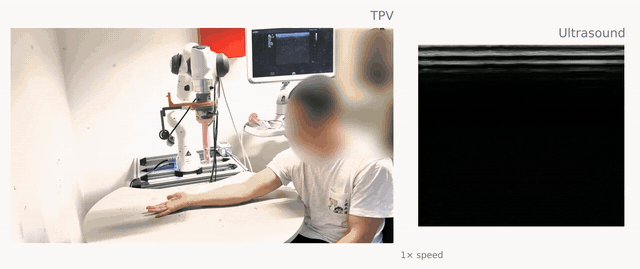 <b>Radial artery</b> · wrist-to-elbow sweep</td>
  </tr>
</table>

<i>Autonomous rollouts on previously unseen participants (Franka Emika Panda). Left: third-person view; right: live ultrasound. Playback speed is shown in each clip.</i>

<!-- Optional: drag the full video into the GitHub web editor here to embed it inline,
     or link the YouTube upload in the badge above. -->

---

## Abstract

Ultrasound imaging is highly operator-dependent, motivating robotic systems that can reproduce expert scanning skills consistently. However, these skills involve coordinated interpretation of anatomical landmarks, ultrasound images, and probe–tissue interactions that are difficult to encode in manually designed control strategies. Imitation learning offers a promising alternative, but its observation and action representations should reflect the anatomically structured nature of scanning.

We propose an **anatomy-anchored imitation-learning framework** that integrates anatomy-guided probe placement with learned ultrasound navigation. The placement module identifies a task-specific anatomical starting point from external visual observations and establishes an initial probe pose as the reference frame for subsequent scanning. A flow-based policy combines anchor-relative probe poses, ultrasound images, probe-mounted camera observations, and contact forces to generate scanning motions, while a termination head predicts task completion. This formulation avoids continuous reliance on third-person vision and reduces dependence on the robot–patient configuration. A handheld acquisition platform enables multimodal demonstrations to be collected during natural freehand scanning without a robot.

On 16 previously unseen participants, task success rates reach 96 %, 94 %, 88 %, and 94 % for kidney, gallbladder, and liver standard-plane acquisition and radial artery sweeping, respectively. Compared with a fine-tuned π0 model, success on the abdominal tasks improves by 10–42 percentage points, with reduced time-to-target, peak contact force, and trajectory jerk. Ablation studies support the complementary contributions of anatomical anchoring, egocentric vision, and force feedback. End-to-end trials with automatic probe placement achieve 90–100 % success, and the policies transfer without retraining to a second robot with 83–100 % success on the selected tasks.

---

## Why anatomy-anchored?

<table>
  <tr>
    <td width="42%">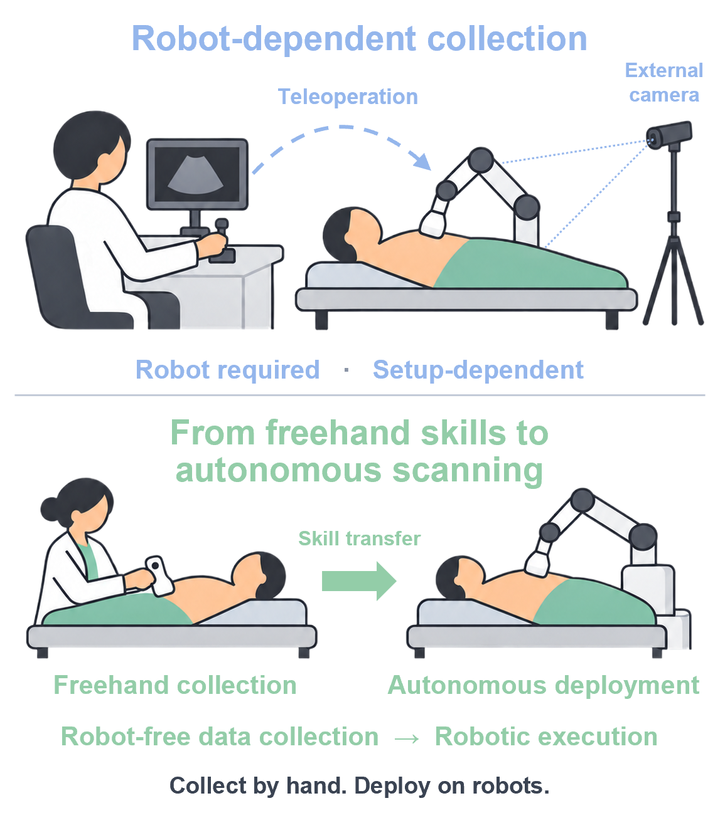</td>
    <td width="58%">

Most imitation-learning pipelines are built for general manipulation: third-person cameras watch the scene, and poses are expressed in the robot-base frame. For ultrasound, that design has two costs:

- **Demonstrations need the robot.** Experts have to teleoperate or hand-guide the arm, which is slow and ties data to one specific setup.
- **Policies inherit the workspace.** A policy that reasons in robot-base coordinates breaks when the patient, bed or robot is placed differently.

But sonographers don't think in robot coordinates. They **start at a landmark** (the xiphoid tip, T12, the wrist) and **navigate relative to it** using the ultrasound image, what they see around the probe, and what they feel through it.

We build the learning problem around exactly that.

  </td>
  </tr>
</table>

---

## Key ideas

### 1 · Split the scan into placement and navigation

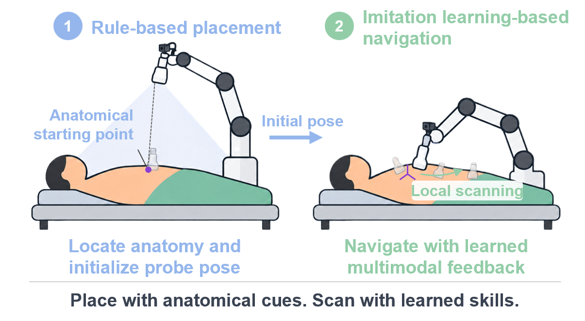

- **Anatomy-guided placement (rule-based).** A scene camera locates a surface landmark — via [HSMR](https://arxiv.org/abs/2503.21751) skeletal reconstruction for abdominal targets, or [MediaPipe Hands](https://developers.google.com/mediapipe) for the wrist — and places the probe perpendicular to the skin at that point.
- **Learned navigation.** Once contact is established, that initial probe pose becomes the **anchor frame {A}**, and the learned policy takes over. External vision is no longer needed.

### 2 · Express probe motion relative to the anatomy

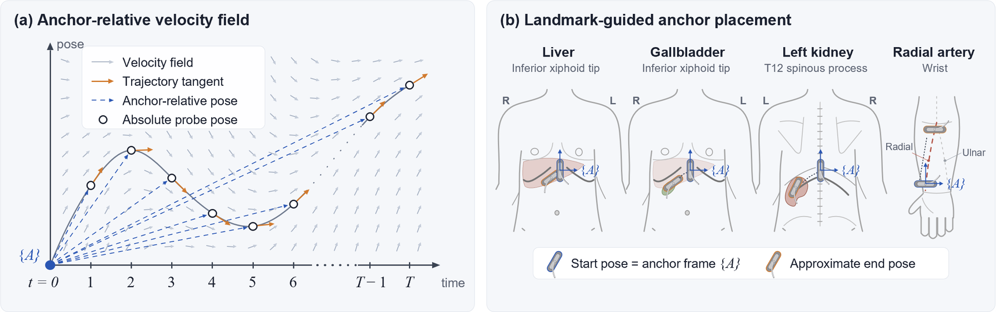

Every probe pose is expressed relative to the fixed episode anchor, ${}^{A}\mathbf{T}_{P_t} = ({}^{G}\mathbf{T}_{A})^{-1}\,{}^{G}\mathbf{T}_{P_t}$. The global frame cancels out, so a trajectory recorded in the **optical-tracker frame** (freehand) and one executed in the **robot-base frame** share the same representation. Because the anchor stays fixed for the whole episode (unlike per-step relative actions), the pose also encodes **how far the scan has progressed** from its anatomical starting point.

| Task | Anchor landmark | Target |
|---|---|---|
| Kidney | T12 surface landmark | Left kidney, longitudinal view |
| Gallbladder | Inferior xiphoid tip | Gallbladder, longitudinal view |
| Liver | Inferior xiphoid tip | Left portal vein with segmental branches |
| Radial artery | Wrist | Radial/ulnar bifurcation (continuous sweep) |

### 3 · Learn from what the sonographer actually uses

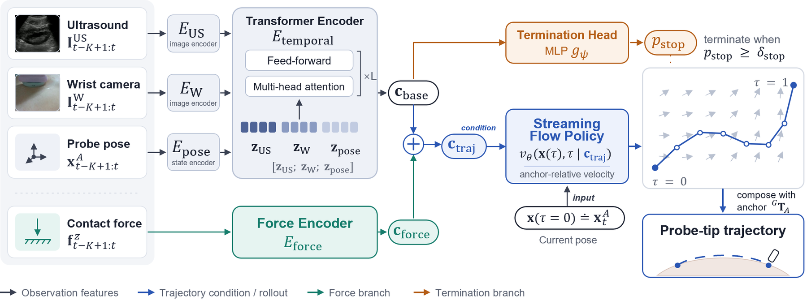

The policy is a **[Streaming Flow Policy](https://arxiv.org/abs/2505.21851)** conditioned on four egocentric signals:

| Modality | What it tells the policy |
|---|---|
| 🩻 **Ultrasound image** | Internal anatomy — the primary cue for reaching the target view |
| 📷 **Wrist camera** | Local probe–skin context and probe motion over the body surface |
| 📍 **Anchor-relative pose** | Spatial progress of the scan relative to the landmark |
| ✋ **Normal contact force** | Probe–tissue interaction, injected as a residual condition |

A conditional velocity field is integrated from the current pose to produce smooth future probe poses, executed in a receding-horizon loop. A separate **termination head** (on a stop-gradient, force-independent feature) decides when the target view has been reached, so the robot knows when to stop.

### 4 · Collect demonstrations without a robot

<table>
  <tr>
    <td width="45%">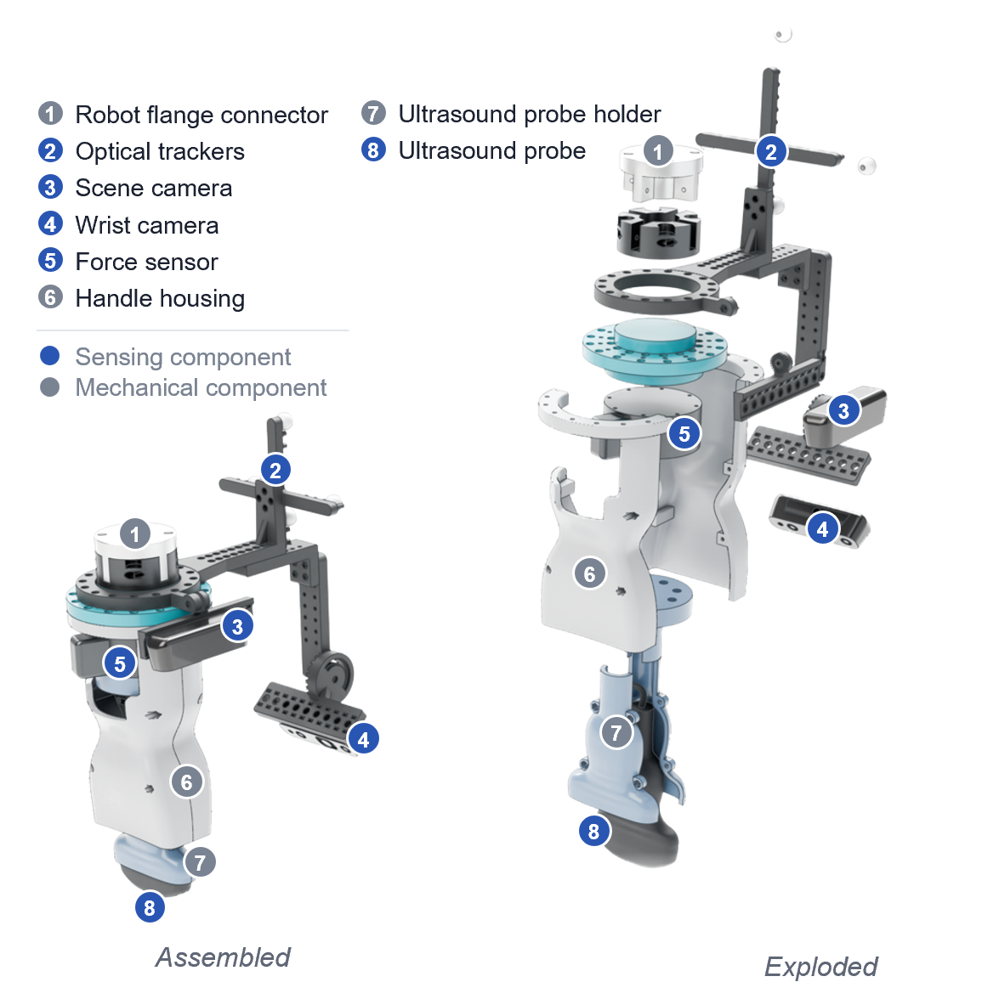</td>
    <td width="55%">

The **handheld acquisition platform** is the same physical tool the robot uses later. It synchronously records:

- B-mode **ultrasound** via a frame grabber (30 Hz)
- **Wrist-camera** RGB of the probe footprint
- **Probe pose** from an NDI optical tracker
- **Contact force** from a 6-axis F/T sensor between handle and probe holder

The force sensor sits in the same load path whether a hand or a robot flange holds the device, so contact forces mean the same thing in demonstration and deployment. After freehand collection, the platform mounts directly on the robot flange.

  </td>
  </tr>
</table>

---

## Results

All evaluations are on **previously unseen participants** (16 participants, 160–190 cm, diverse genders and ethnic backgrounds), with 50 rollouts per task and method. Image quality was rated blind by six physicians.

### Comparison with fine-tuned π0

| Task | Method | Success ↑ | ROI quality ↑ | Auto-stop ↑ | Time-to-target ↓ | Jerk ↓ |
|---|---|:-:|:-:|:-:|:-:|:-:|
| Kidney | Fine-tuned π0 | 86.0 % | 2.78 | 23.3 % | 11.2 s | 0.444 |
| | **Ours** | **96.0 %** | **3.47** | **97.9 %** | **5.7 s** | **0.292** |
| Gallbladder | Fine-tuned π0 | 52.0 % | 2.19 | 19.2 % | 18.1 s | 0.376 |
| | **Ours** | **94.0 %** | **3.97** | **93.6 %** | **9.7 s** | **0.262** |
| Liver | Fine-tuned π0 | 58.0 % | 2.64 | 17.2 % | 12.8 s | 0.420 |
| | **Ours** | **88.0 %** | **3.78** | **95.5 %** | **9.5 s** | **0.217** |
| Radial artery | Fine-tuned π0 | 70.0 % | 65.9 %‡ | 28.6 % | 17.9 s | 0.605 |
| | **Ours** | **94.0 %** | **99.6 %**‡ | **100 %** | **11.7 s** | 0.625 |

ROI quality: physician rating on a 1–5 scale. ‡ For the radial artery: vessel visibility ratio along the sweep. Jerk in m/s³.

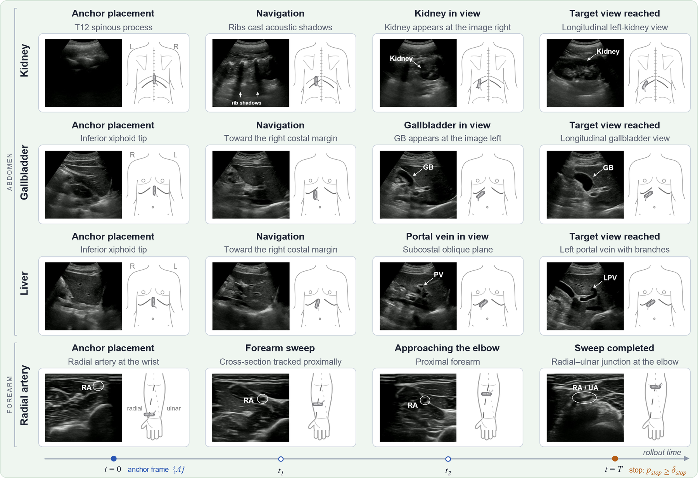

### Robustness to setup changes

When the setup is **rotated relative to data collection**, an absolute-pose policy breaks down, while the anchor-relative policy is essentially unaffected.

| Task (rotation) | Absolute pose | **Anatomy-anchored (ours)** |
|---|:-:|:-:|
| Kidney (45°) | 70.0 % | **93.3 %** |
| Radial artery (90°) | 0.0 % | **94.0 %** |

Ablations also show that removing the **wrist camera** (kidney 96 → 77 %, radial artery 94 → 65 %) or **force input** (higher and more variable peak forces) each hurts performance.

### End-to-end with automatic placement

With the full pipeline (landmark detection → automatic placement → learned navigation), success stays on par with manual placement: **100 %** kidney, **93.3 %** gallbladder, **90 %** liver and **90 %** radial artery (30 rollouts each).

### Cross-embodiment transfer — no retraining

<table>
  <tr>
    <td width="50%" align="center">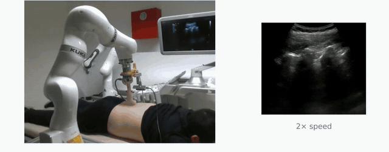 <i>Kidney scan on a KUKA LBR iiwa 7 R800 with a policy trained only on freehand data</i></td>
    <td width="50%">

Policies trained on freehand demonstrations were deployed on a second robot, a **KUKA LBR iiwa 7 R800**, with only the mechanical mount and its end-effector-to-probe transform changed.

| Task | Franka | KUKA |
|---|:-:|:-:|
| Kidney | 96.0 % | 100.0 % |
| Gallbladder | 94.0 % | 86.7 % |
| Liver | 88.0 % | 93.3 % |
| Radial artery | 94.0 % | 83.3 % |

  </td>
  </tr>
</table>

---

## Dataset at a glance

| Region | Task | Demos | Volunteers |
|---|---|:-:|:-:|
| Abdomen | Kidney | 69 | 5 |
| Abdomen | Gallbladder | 60 | 5 |
| Abdomen | Liver | 82 | 5 |
| Forearm | Radial artery | 83 | 2 |
| | **Total** | **294** | |

All demonstrations were collected freehand with the acquisition platform under institutional ethics approval.

---

## 🗺️ Roadmap

- [x] Project page & README
- [ ] Paper on arXiv
- [ ] Hardware: CAD files for the handheld acquisition platform & bill of materials
- [ ] Data acquisition & synchronization tools (ROS)
- [ ] Training code for the anatomy-anchored Streaming Flow Policy
- [ ] Anatomy-guided placement module
- [ ] Robot deployment code (Franka / KUKA)
- [ ] Pretrained checkpoints

⭐ **Star / watch this repo** to get notified when the code is released.

---

## Citation

The BibTeX entry will be added after the review process.

## Acknowledgements

This work builds on [Streaming Flow Policy](https://arxiv.org/abs/2505.21851), [HSMR](https://arxiv.org/abs/2503.21751), [MediaPipe](https://developers.google.com/mediapipe), [π0](https://arxiv.org/abs/2410.24164) (baseline) and [EchoCare](https://arxiv.org/abs/2509.11752) (best-view selection encoder). We thank all volunteers who participated in the data collection and evaluation, and the physicians who rated the acquired images.

## Contact

For questions, please open an issue in this repository.

## License

To be announced with the code release.
